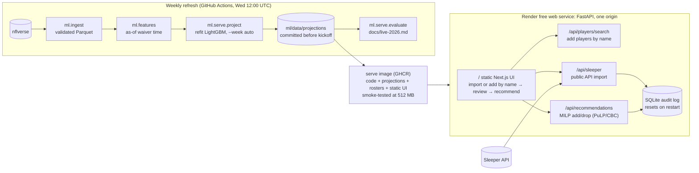

# Architecture

## How the pieces fit

- **`ml/` has no web code.** Ingest writes one Parquet file per dataset and season. Features
  take an explicit `as_of` week and use only data from before it. The backtest and the live job
  call the same feature code, so the live system is the system that was evaluated.
- **The API reads files, not a model server.** Each week's projections are a small Parquet
  file (about 20 KB). The deploy bakes it into the image, so a release is immutable. Rolling
  back the app also rolls back the data it served, and the API needs no object store.
- **The database holds only what users create:** imported rosters and recommendations, as an
  audit log nothing reads back. Production runs it as SQLite inside the container, which
  resets on restart, so hosting stays free; Postgres works by setting `DATABASE_URL`
  (docker-compose and CI test it).
- **One origin.** The UI is a static export served by the API, so there's no CORS setup and
  one URL to deploy.
- **Two ways in, one review step.** A Sleeper import or players added by name produce the same
  reviewed, ID-matched roster. The optimizer doesn't know which path the roster came from.
  (Screenshot parsing was a third path until it was removed; see decisions.md.)

Hosting choices and their reasons are in [decisions.md](decisions.md); operating it is in
[deploy.md](deploy.md).
