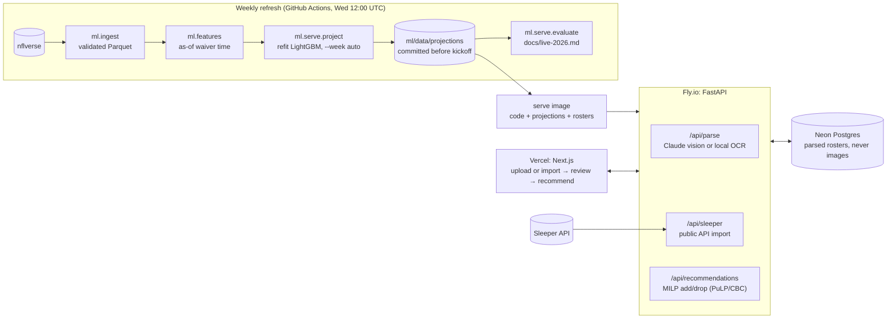

# Architecture

## How the pieces fit

- **`ml/` has no web code.** Ingest writes one Parquet file per dataset and season. Features
  take an explicit `as_of` week and use only data from before it. The backtest and the live job
  call the same feature code, so the live system is the system that was evaluated.
- **The API reads files, not a model server.** Each week's projections are a small Parquet
  file (about 20 KB). The deploy bakes it into the image, so a release is immutable. Rolling
  back the app also rolls back the data it served, and the API needs no object store.
- **Postgres holds only what users create:** parsed rosters and recommendations, for review
  and debugging. Screenshots are never stored.
- **Two ways in, one review step.** A screenshot (Claude vision when configured, otherwise free
  local OCR) or a Sleeper import produces the same reviewed, ID-matched roster. The optimizer
  doesn't know which path the roster came from.

Hosting choices and their reasons are in [decisions.md](decisions.md); operating it is in
[deploy.md](deploy.md).
